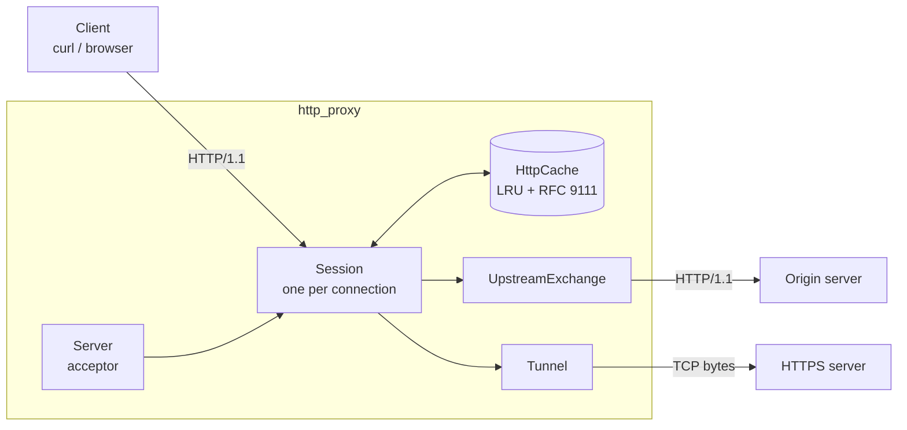
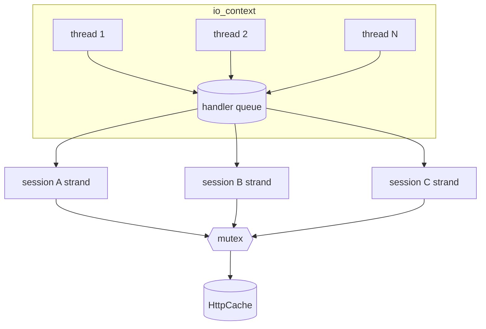
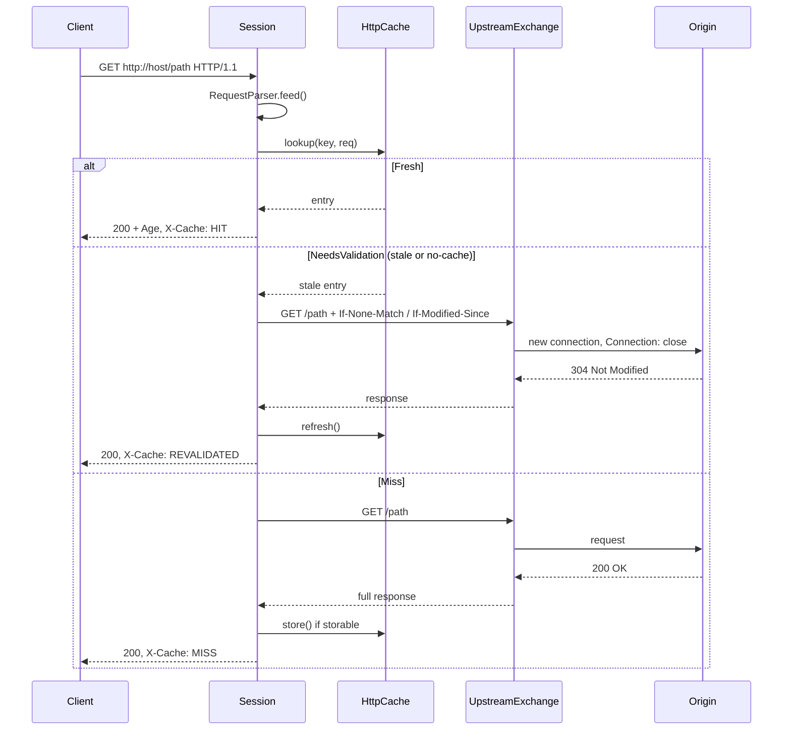
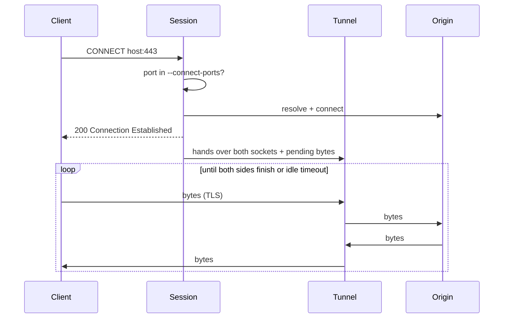

# ARCHITECTURE - ᴇɴ

This document describes how the proxy is organized, how a request flows through it and the design decisions behind it.

- [How to run](README.md)
- [Versão em português](ARCHITECTURE.pt-br.md)

## 1. Overview

The proxy is a single C++17 process with fully asynchronous I/O on Boost.Asio. It accepts HTTP/1.1 client connections, forwards requests to origin servers, stores responses in an in-memory cache following RFC 9111, and opens TCP tunnels for `CONNECT` (HTTPS).



## 2. Layers and modules

The code lives in `src/`, split into layers that only depend on the layers below them:

```
main.cpp          CLI, io_context, thread pool, signals
   │
proxy/            networking: accept, sessions, upstream, tunnels, timeouts
   │
cache/            caching policy (RFC 9111) and LRU
   │
http/             messages, parser, URLs, dates (no I/O)
   │
util/             strings, logger
```

| Module | Files | Responsibility |
| --- | --- | --- |
| `util` | `strings.hpp`, `logger.*` | string helpers (trim, case-insensitive compare, integer parsing) and a thread-safe logger with `LOG_*` macros that only evaluate their expression when the level is enabled |
| `http` | `message.*` | `Headers` (ordered, case-insensitive lookup, duplicates kept), `Request`, `Response`, serialization, hop-by-hop header removal |
| | `parser.*` | incremental HTTP/1.1 parser (RFC 9112) for requests and responses |
| | `url.*` | parsing of absolute `http://` URLs and CONNECT `host:port`, normalization, relative reference resolution |
| | `date.*` | HTTP date parsing/formatting (IMF-fixdate, RFC 850, asctime) |
| `cache` | `lru_cache.hpp` | generic `LruCache<K,V>` bounded by total cost, O(1) |
| | `cache_control.*` | `Cache-Control` directive parsing |
| | `http_cache.*` | `HttpCache`: storability, freshness, age, revalidation, `Vary` |
| `proxy` | `config.*` | `Config` and command-line parsing |
| | `server.*` | `Server` (acceptor) and `ProxyContext` (shared state) |
| | `session.*` | `Session`: lifecycle of one client connection |
| | `upstream.*` | `UpstreamExchange`: one request/response exchange with the origin |
| | `tunnel.*` | `Tunnel`: bidirectional byte relay for CONNECT |
| | `deadline.hpp` | `Deadline`: inactivity watchdog on a `steady_timer` |

CMake builds everything except `main.cpp` into the static library `proxy_core`; both the `http_proxy` executable and the `proxy_tests` binary link against it.

## 3. Concurrency model



- **One `io_context`, N threads.** `main.cpp` creates a pool (default: one thread per CPU) where every thread calls `io.run()` and picks up whichever handler is ready.
- **One strand per connection.** `Server` accepts each socket already bound to `make_strand(io)`. Every handler of a `Session`, and of its `UpstreamExchange`, `Tunnel` and `Deadline`s, runs serialized on that strand. Session state therefore **needs no locks**, while different sessions run in parallel.
- **Minimal shared state.** What all sessions share lives in `ProxyContext`:
  - `Config` (read-only after startup);
  - `HttpCache`, internally guarded by a `std::mutex`;
  - `ProxyStats`, `std::atomic` counters.
- **Immutable entries.** The cache stores `std::shared_ptr<const CacheEntry>`. A session holding an entry can keep using it outside the lock even if another thread replaces or evicts it.
- **Lifetime via `shared_from_this`.** `Session`, `UpstreamExchange` and `Tunnel` are kept alive by their pending asynchronous operations, which capture a `shared_ptr`. When the last operation completes, the object is destroyed.

## 4. Request lifecycle



Step by step inside `Session`:

1. **Reading** (`do_read` / `on_read`): bytes go into `pending_`, and the parser only consumes what belongs to the current message. The rest is kept for the next request (pipelining) or for the tunnel.
2. **`Expect: 100-continue`**: once headers arrive with that token, the session answers `100 Continue` itself and strips the header before forwarding.
3. **Dispatch** (`handle_request`):
   - `CONNECT` → `handle_connect`;
   - origin-form target (`/...`) → `handle_local` (only `GET /__proxy/stats`);
   - scheme other than `http` → `400`;
   - `Via` header containing the proxy's token → `508` (loop);
   - non-conditional `GET` with the cache enabled → `HttpCache` lookup.
4. **Forwarding** (`forward`): builds the upstream request in origin-form, removes hop-by-hop headers and `Expect`, rewrites `Host`, adds validators when revalidating, appends `Via` and forces `Connection: close`.
5. **Upstream response** (`on_upstream`):
   - `304` to a revalidation → `HttpCache::refresh` merges the headers and the updated entry is served;
   - `GET` → `HttpCache::store` (if policy allows; otherwise a stale entry is invalidated);
   - unsafe method (`POST`, `PUT`, `DELETE`, ...) with status `< 400` → invalidates the target URI and same-origin `Location`/`Content-Location` URIs.
6. **Writing** (`send_response`): removes hop-by-hop headers, re-frames with `Content-Length` (the body is fully buffered and de-chunked), adds `Via`, `X-Cache` and `Connection`, logs the access line and writes.
7. **Keep-alive**: if the client wants to keep the connection, `on_write` calls `process()` again, which may already have another request in `pending_`.

### CONNECT



After `200 Connection Established`, the `Session` marks itself finished and hands both sockets to a `Tunnel`. The tunnel copies bytes in both directions through 16 KiB buffers. When one side sends EOF, the tunnel calls `shutdown(send)` on the other (half-close) and keeps relaying the remaining direction until it ends too. The traffic is encrypted and never cached.

## 5. HTTP parser

`http::ParserBase` is an incremental state machine shared by `RequestParser` and `ResponseParser`:

```
StartLine → Header → ┬─ (no body) ───────────────────────────→ Done
                     ├─ FixedBody (Content-Length) ──────────→ Done
                     ├─ ChunkSize ⇄ ChunkData → ChunkDataEnd
                     │       └─ (chunk 0) → Trailer ─────────→ Done
                     └─ UntilClose (responses) ─ finish() ───→ Done
```

- `feed(data)` returns how many bytes it consumed; the caller keeps the rest.
- Chunked bodies are decoded, so the final message no longer depends on `Transfer-Encoding`.
- Request smuggling protection: `Transfer-Encoding` overrides `Content-Length`, which is dropped; an invalid or inconsistent `Content-Length` is an error, and so is an unknown transfer coding in a request.
- `ResponseParser` knows the request method: responses to `HEAD`, and `1xx`, `204` and `304` responses, have no body; interim `1xx` responses are discarded.
- Limits (`ParserLimits`): 64 KiB for the start line plus headers, 100 header fields, and bodies up to 64 MiB (never less than `--max-object`).

## 6. Cache

### Structure

`HttpCache` combines an `LruCache<std::string, EntryPtr>` with the RFC 9111 policy. The key is the normalized absolute URL (`http::Url::to_string()`). Each entry's cost is the approximate byte size of its headers plus body. `LruCache` uses a `std::list` (recency order) and a `std::unordered_map` pointing into it, giving O(1) `get`/`put`; when over capacity it evicts the least recently used entries.

### What can be stored (`is_storable`)

A response is stored only if:

- the request is a `GET` without `Cache-Control: no-store`;
- the status is not `1xx`, `206` or `304`;
- the response has neither `no-store` nor `private`;
- requests with `Authorization` only when the response has `public`, `s-maxage` or `must-revalidate`;
- `Vary: *` is never stored;
- responses with `Set-Cookie` only with `public`;
- there is explicit freshness information (`max-age`, `s-maxage`, `Expires`) **or** the status is cacheable by default and validators exist (`ETag`/`Last-Modified`);
- the size does not exceed `--max-object`.

### Freshness and age

- **Freshness lifetime** (`freshness_lifetime`): `s-maxage` > `max-age` > `Expires − Date` > heuristic of 10% of `Date − Last-Modified`, capped at 24 h.
- **Age** (`current_age`): follows RFC 9111 §4.2.3, combining the received `Age` header, the difference between `Date` and the response time, and how long the entry has been cached.
- **Request directives**: `no-cache` and `Pragma: no-cache` force revalidation; `max-age` and `min-fresh` narrow freshness; `max-stale` allows serving stale content unless the response has `must-revalidate`, `proxy-revalidate` or `s-maxage`; `only-if-cached` returns `504` on a miss.

### Revalidation

When `lookup` returns `NeedsValidation`, the session sends `If-None-Match` (from `ETag`) and/or `If-Modified-Since` (from `Last-Modified`). A `304` is merged into the stored entry by `refresh` (RFC 9111 §4.3.4), which updates the headers and recomputes age and freshness. Any other status replaces or invalidates the entry. Requests that are already conditional from the client are simply forwarded.

### `Vary`

The entry stores the request header values named by `Vary`. A lookup only matches when the new request has the same values; otherwise it counts as a miss.

## 7. Timeouts

Every timeout uses `Deadline`, a watchdog with a single `steady_timer` per owner. Instead of cancelling and re-arming the timer on every I/O completion, the owner only calls `extend()` to push the deadline forward; when the timer fires it compares the clock with the current deadline and either expires or waits again. The timer state lives in a shared block captured by the handler, so the owner can be destroyed while a cancelled wait is still queued.

| Where | Timeout | Default | On expiry |
| --- | --- | --- | --- |
| `Session` | `--idle-timeout` | 60 s | closes the idle client connection; suspended while the origin is answering |
| `UpstreamExchange` | `--timeout` | 30 s | cancels the exchange, the client gets `504` |
| `Session` (CONNECT) | `--timeout` | 30 s | bounds tunnel resolve + connect |
| `Tunnel` | `--tunnel-timeout` | 300 s | closes both sides of an idle tunnel |

## 8. Design decisions and limitations

- **Buffered responses.** The upstream response is read completely before it is sent to the client. This keeps caching and re-framing simple, at the cost of latency and memory for large responses (bounded by `ParserLimits::max_body_bytes`).
- **No upstream connection pool.** Every request opens a new connection with `Connection: close`.
- **Memory-only cache.** Contents are lost on restart.
- **No authentication or ACLs.** That is why it listens on `127.0.0.1` by default.
- **No TLS interception.** HTTPS is only tunnelled, never cached.
- **HTTP/1.x only.** No HTTP/2 or HTTP/3.

Possible next steps: streaming of large responses, connection pooling, on-disk cache, `stale-while-revalidate`, `Proxy-Authorization`, and Prometheus-style metrics.

by caiothedev<br />
#architecture