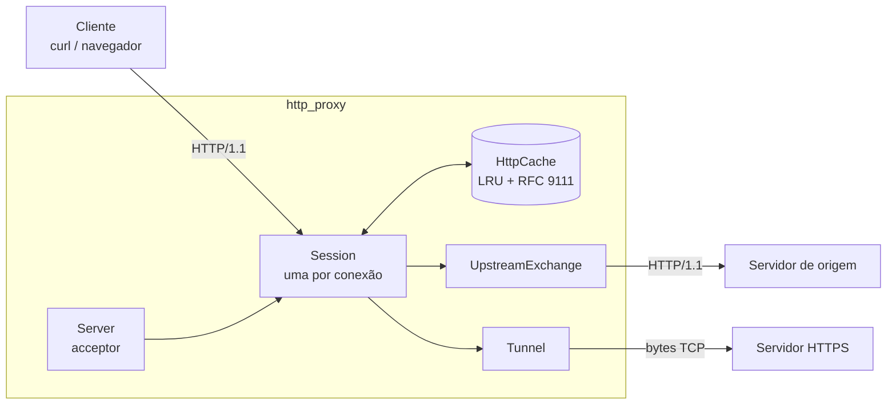
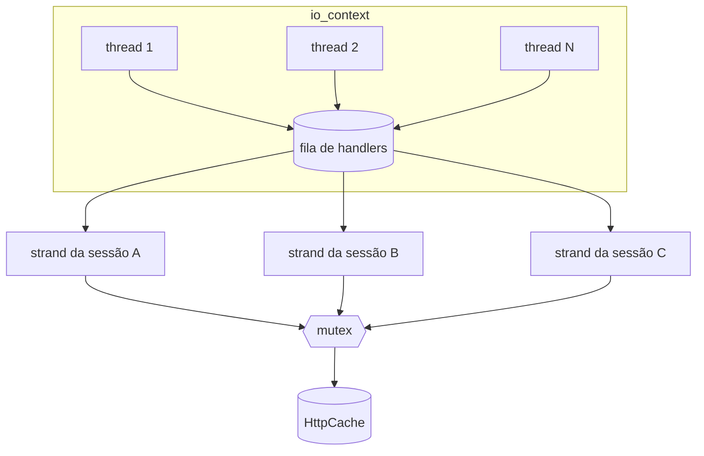
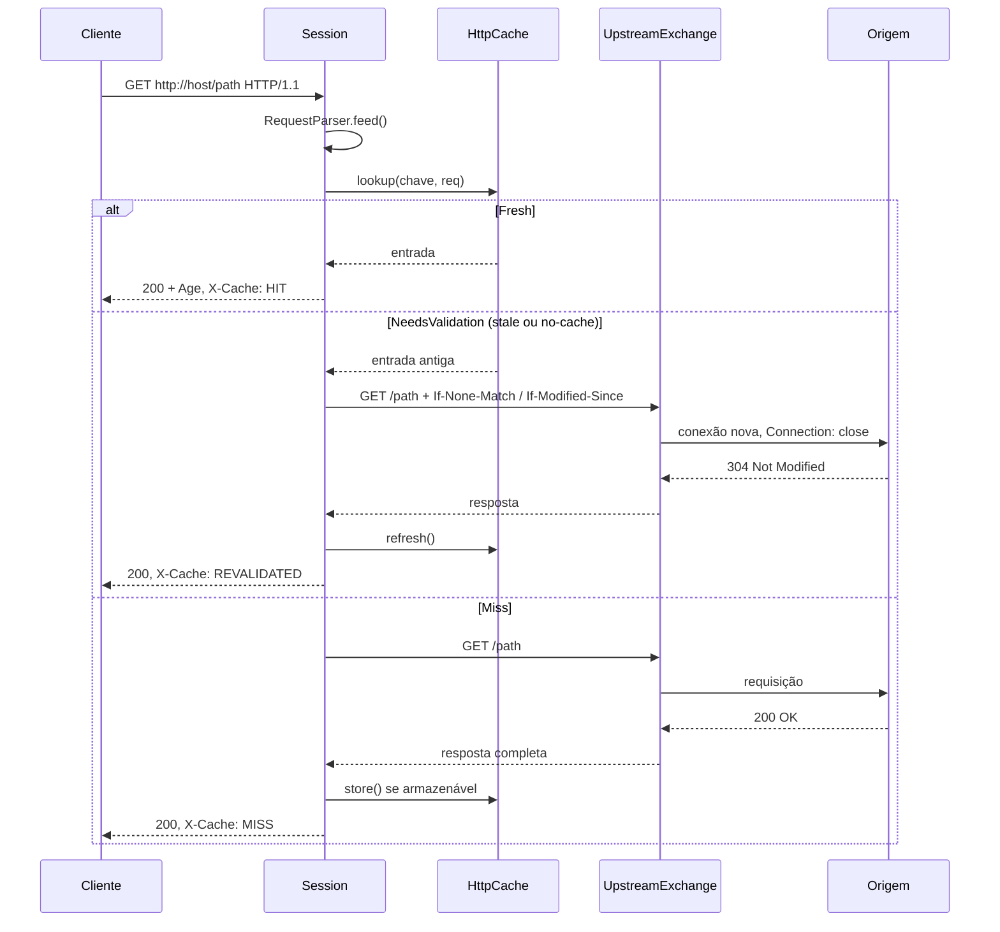
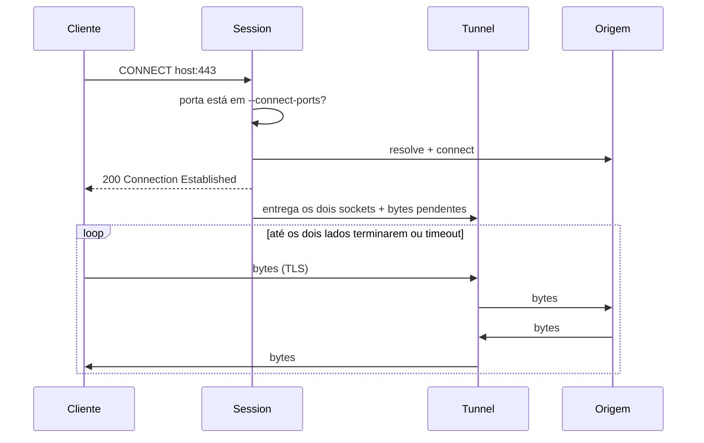

# ARQUITETURA - ᴘᴛ

Este documento descreve como o proxy é organizado, como uma requisição percorre o sistema e quais decisões de projeto foram tomadas.

- [Como rodar](README.pt-br.md)
- [English version](ARCHITECTURE.en.md)

## 1. Visão geral

O proxy é um único processo C++17 com I/O totalmente assíncrono sobre Boost.Asio. Ele aceita conexões de clientes HTTP/1.1, encaminha requisições para servidores de origem, guarda respostas num cache em memória segundo a RFC 9111 e cria túneis TCP para `CONNECT` (HTTPS).



## 2. Camadas e módulos

O código fica em `src/`, dividido em camadas que só dependem das camadas abaixo:

```
main.cpp          CLI, io_context, pool de threads, sinais
   │
proxy/            rede: aceitar, sessões, origem, túneis, timeouts
   │
cache/            política de cache (RFC 9111) e LRU
   │
http/             mensagens, parser, URLs, datas (sem I/O)
   │
util/             strings, logger
```

| Módulo | Arquivos | Responsabilidade |
| --- | --- | --- |
| `util` | `strings.hpp`, `logger.*` | utilitários de string (trim, comparação sem case, parse de inteiros) e logger thread-safe com macros `LOG_*` que só avaliam a expressão quando o nível está ativo |
| `http` | `message.*` | `Headers` (ordenados, busca sem diferenciar maiúsculas, duplicatas preservadas), `Request`, `Response`, serialização, remoção de headers *hop-by-hop* |
| | `parser.*` | parser HTTP/1.1 incremental (RFC 9112) para requisições e respostas |
| | `url.*` | parsing de URLs `http://` absolutas, `host:porta` do CONNECT, normalização e resolução de referências relativas |
| | `date.*` | parsing/formatação de datas HTTP (IMF-fixdate, RFC 850, asctime) |
| `cache` | `lru_cache.hpp` | `LruCache<K,V>` genérico limitado por custo total, O(1) |
| | `cache_control.*` | parsing das diretivas `Cache-Control` |
| | `http_cache.*` | `HttpCache`: decide o que armazenar, frescor, idade, revalidação, `Vary` |
| `proxy` | `config.*` | `Config` e parsing da linha de comando |
| | `server.*` | `Server` (acceptor) e `ProxyContext` (estado compartilhado) |
| | `session.*` | `Session`: ciclo de vida de uma conexão de cliente |
| | `upstream.*` | `UpstreamExchange`: uma troca requisição/resposta com a origem |
| | `tunnel.*` | `Tunnel`: relay bidirecional de bytes para CONNECT |
| | `deadline.hpp` | `Deadline`: watchdog de inatividade sobre um `steady_timer` |

O CMake compila tudo exceto `main.cpp` na biblioteca estática `proxy_core`; o executável `http_proxy` e os testes `proxy_tests` linkam contra ela.

## 3. Modelo de concorrência



- **Um `io_context`, N threads.** `main.cpp` cria um pool (padrão: uma thread por CPU) em que todas as threads chamam `io.run()` e executam qualquer handler pronto.
- **Um *strand* por conexão.** O `Server` aceita cada socket já associado a um `make_strand(io)`. Todos os handlers de uma `Session`, do seu `UpstreamExchange`, do seu `Tunnel` e dos seus `Deadline` rodam serializados nesse strand. Por isso o estado da sessão **não precisa de locks**, enquanto sessões diferentes rodam em paralelo.
- **Estado compartilhado mínimo.** O que é comum a todas as sessões fica em `ProxyContext`:
  - `Config` (somente leitura após o início);
  - `HttpCache`, protegido internamente por um `std::mutex`;
  - `ProxyStats`, contadores `std::atomic`.
- **Entradas imutáveis.** O cache guarda `std::shared_ptr<const CacheEntry>`. Uma sessão que obteve uma entrada pode continuar usando-a fora do lock, mesmo que outra thread a substitua ou a remova do cache.
- **Tempo de vida por `shared_from_this`.** `Session`, `UpstreamExchange` e `Tunnel` são mantidos vivos pelas operações assíncronas pendentes, que capturam um `shared_ptr`. Quando a última operação termina, o objeto é destruído.

## 4. Ciclo de vida de uma requisição



Passo a passo em `Session`:

1. **Leitura** (`do_read` / `on_read`): bytes lidos vão para `pending_`, e o parser consome só o que pertence à mensagem atual. O que sobra fica guardado para a próxima requisição (*pipelining*) ou para o túnel.
2. **`Expect: 100-continue`**: quando os headers chegam com esse token, a sessão responde `100 Continue` ela mesma e remove o header antes de encaminhar.
3. **Despacho** (`handle_request`):
   - `CONNECT` → `handle_connect`;
   - alvo em *origin-form* (`/...`) → `handle_local` (só `GET /__proxy/stats`);
   - esquema diferente de `http` → `400`;
   - header `Via` com o token do proxy → `508` (loop);
   - `GET` não condicional com cache ativo → consulta o `HttpCache`.
4. **Encaminhamento** (`forward`): monta a requisição para a origem em *origin-form*, remove headers *hop-by-hop* e `Expect`, reescreve `Host`, adiciona validadores se estiver revalidando, acrescenta `Via` e força `Connection: close`.
5. **Resposta da origem** (`on_upstream`):
   - `304` para uma revalidação → `HttpCache::refresh` mescla os headers e a entrada atualizada é servida;
   - `GET` → `HttpCache::store` (se a política permitir; se não, uma entrada antiga é invalidada);
   - método inseguro (`POST`, `PUT`, `DELETE`, ...) com status `< 400` → invalida a URI alvo e as URIs de `Location`/`Content-Location` da mesma origem.
6. **Escrita** (`send_response`): remove headers *hop-by-hop*, refaz o framing com `Content-Length` (o corpo já está todo em memória e decodificado), adiciona `Via`, `X-Cache` e `Connection`, registra a linha de log e escreve.
7. **Keep-alive**: se o cliente quer manter a conexão, `on_write` volta a `process()`, que pode já ter outra requisição em `pending_`.

### CONNECT



Depois do `200 Connection Established`, a `Session` se marca como encerrada e passa os dois sockets para um `Tunnel`. O túnel copia bytes nas duas direções com buffers de 16 KiB. Quando um lado envia EOF, o túnel faz `shutdown(send)` no outro (*half-close*) e continua a outra direção até ela também terminar. O tráfego é criptografado e nunca é cacheado.

## 5. Parser HTTP

`http::ParserBase` é uma máquina de estados incremental, compartilhada por `RequestParser` e `ResponseParser`:

```
StartLine → Header → ┬─ (sem corpo) ─────────────────────────→ Done
                     ├─ FixedBody (Content-Length) ──────────→ Done
                     ├─ ChunkSize ⇄ ChunkData → ChunkDataEnd
                     │       └─ (chunk 0) → Trailer ─────────→ Done
                     └─ UntilClose (só respostas) ─ finish() → Done
```

- `feed(data)` devolve quantos bytes consumiu; o chamador guarda o resto.
- Corpos *chunked* são decodificados, então a mensagem final não depende de `Transfer-Encoding`.
- Proteção contra *request smuggling*: `Transfer-Encoding` prevalece sobre `Content-Length`, que é descartado; `Content-Length` inválido ou com valores divergentes gera erro, assim como um *transfer-coding* desconhecido numa requisição.
- `ResponseParser` conhece o método da requisição: respostas a `HEAD`, `1xx`, `204` e `304` não têm corpo; respostas `1xx` intermediárias são descartadas.
- Limites (`ParserLimits`): 64 KiB de linha inicial + headers, 100 headers, e corpo de até 64 MiB (nunca menor que `--max-object`).

## 6. Cache

### Estrutura

`HttpCache` combina uma `LruCache<std::string, EntryPtr>` com a política da RFC 9111. A chave é a URL absoluta normalizada (`http::Url::to_string()`). O custo de cada entrada é o tamanho aproximado em bytes de headers + corpo. A `LruCache` usa uma `std::list` (ordem de uso) e um `std::unordered_map` apontando para os nós, com `get`/`put` em O(1). Ao passar do limite, remove as entradas usadas há mais tempo.

### O que pode ser armazenado (`is_storable`)

Uma resposta só é guardada se:

- a requisição é `GET` e não tem `Cache-Control: no-store`;
- o status não é `1xx`, `206` ou `304`;
- a resposta não tem `no-store` nem `private`;
- requisições com `Authorization` só se a resposta tiver `public`, `s-maxage` ou `must-revalidate`;
- `Vary: *` nunca é guardado;
- respostas com `Set-Cookie` só com `public`;
- há informação de frescor explícita (`max-age`, `s-maxage`, `Expires`) **ou** o status é cacheável por padrão e há validadores (`ETag`/`Last-Modified`);
- o tamanho não passa de `--max-object`.

### Frescor e idade

- **Tempo de vida** (`freshness_lifetime`): `s-maxage` > `max-age` > `Expires − Date` > heurística de 10% de `Date − Last-Modified`, limitada a 24 h.
- **Idade** (`current_age`): segue a RFC 9111 §4.2.3, combinando o header `Age` recebido, a diferença entre `Date` e o horário da resposta, e o tempo que a entrada está no cache.
- **Diretivas da requisição**: `no-cache` e `Pragma: no-cache` forçam revalidação; `max-age` e `min-fresh` restringem; `max-stale` permite servir conteúdo vencido, exceto quando a resposta tem `must-revalidate`, `proxy-revalidate` ou `s-maxage`; `only-if-cached` devolve `504` em caso de miss.

### Revalidação

Quando `lookup` retorna `NeedsValidation`, a sessão envia `If-None-Match` (do `ETag`) e/ou `If-Modified-Since` (do `Last-Modified`). Um `304` é mesclado na entrada antiga por `refresh` (RFC 9111 §4.3.4), que substitui os headers atualizados e recalcula idade e frescor. Qualquer outro status substitui ou invalida a entrada. Requisições que já vêm condicionais do cliente são apenas repassadas.

### `Vary`

A entrada guarda os valores dos headers da requisição nomeados em `Vary`. Um `lookup` só é aceito se a nova requisição tiver os mesmos valores; caso contrário é tratado como miss.

## 7. Timeouts

Todos os timeouts usam `Deadline`, um watchdog com um único `steady_timer` por objeto. Em vez de cancelar e reprogramar o timer a cada operação de I/O, o dono só chama `extend()` para empurrar o prazo; quando o timer dispara, ele compara o relógio com o prazo atual e expira ou volta a esperar. O estado do timer fica num bloco compartilhado capturado pelo handler, então o dono pode ser destruído com uma espera cancelada ainda na fila.

| Onde | Timeout | Padrão | Efeito ao expirar |
| --- | --- | --- | --- |
| `Session` | `--idle-timeout` | 60 s | fecha a conexão do cliente ocioso; suspenso enquanto a origem responde |
| `UpstreamExchange` | `--timeout` | 30 s | cancela a troca, o cliente recebe `504` |
| `Session` (CONNECT) | `--timeout` | 30 s | limita resolve + connect do túnel |
| `Tunnel` | `--tunnel-timeout` | 300 s | fecha os dois lados do túnel ocioso |

## 8. Decisões e limitações

- **Respostas em buffer.** A resposta da origem é lida inteira antes de ser enviada ao cliente. Isso simplifica o cache e o reframing, mas aumenta a latência e o uso de memória para respostas grandes (limitadas por `ParserLimits::max_body_bytes`).
- **Sem pool de conexões com a origem.** Cada requisição abre uma conexão nova com `Connection: close`.
- **Cache só em memória.** O conteúdo é perdido ao reiniciar.
- **Sem autenticação nem ACL.** Por isso o padrão é escutar em `127.0.0.1`.
- **Sem interceptação TLS.** HTTPS só passa por túnel, sem cache.
- **Apenas HTTP/1.x.** Não há suporte a HTTP/2 ou HTTP/3.

Possíveis evoluções: streaming de respostas grandes, pool de conexões, cache em disco, `stale-while-revalidate`, autenticação `Proxy-Authorization` e métricas no formato Prometheus.

by caiothedev<br />
#architecture

## Timeouts da origem

Cada troca com a origem possui dois prazos independentes, configurados por `--timeout`: um prazo absoluto, iniciado antes da resolução DNS e nunca estendido, e um prazo de inatividade, renovado somente quando uma etapa termina ou chegam bytes da resposta. O envio contínuo de pequenos fragmentos não mantém a troca ativa além do prazo absoluto.
